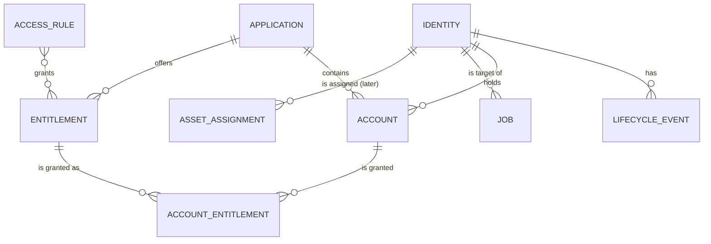

# IAMasC concept

IAMasC tracks every person from the day HR records the hire to the day their last account is deleted, and records every permission they held in between. This document is the long-term shape. Each feature that ships should fit it; when one doesn't, change this document in the same PR.

Clickable mockups of the first screens: [docs/mockups/index.html](mockups/index.html) (open it in a browser).

## What it does

1. HR tells IAMasC someone is joining, changing jobs, or leaving. Sources: ADP Workforce Now, a CSV export, or a person typing it in.
2. IAMasC works out what access that person should have from **access rules** (department, title, location, worker type).
3. It schedules **jobs** that create, change, or remove accounts in each connected application, starting with Active Directory.
4. Every night it compares what each application says the person has against what IAMasC granted, and flags the difference (**drift**) and accounts nobody owns (**orphans**).
5. Every action lands in an append-only audit log, so "who had access to what, when, and who approved it" has an answer years later.

## Domain model

| Entity | Meaning |
| --- | --- |
| Identity | One real person, keyed by HR employee ID. Status: Pending, Active, Offboarding, Terminated. Rehires reuse the same identity. |
| Lifecycle event | Hire, Change, Terminate, or Rehire, with effective date, source (ADP, CSV, manual), and the raw HR payload. |
| Application | A connected system: Active Directory first, then Entra ID / Microsoft 365 and others. |
| Account | An identity's account in one application (AD: `objectGUID`, `sAMAccountName`, UPN, OU). |
| Entitlement | Something an application can grant: an AD group now; roles, licenses, and seats later. |
| Account entitlement | A grant with its origin (Rule, Manual, Discovered), who granted it, when, and when it was revoked. Revoked rows are kept forever. |
| Access rule | Conditions on HR fields mapped to entitlements and a target OU. All matching rules apply; the highest-ordered rule picks the OU. |
| Job | One change in one application, scheduled for a time, retried up to 3 times, then left for a person. |
| Audit entry | Who did what, to whom, with before and after values. Append-only. |
| Asset assignment | Later: software and hardware from the inventory connector. |

## Joiner, mover, leaver for Active Directory

**Joiner.** The hire is recorded as Pending. N days before the start date (default 3) a job creates the AD account **disabled**, with a random password, in the OU from access rules, and adds the rule groups. On the start date another job enables it. The username follows a naming rule with collision handling (`glindqvist`, then `glindqvist2`), and a collision with a disabled or orphaned account stops the job for a person to decide.

**Mover.** A department, title, location, or worker-type change recalculates the rule-based access. Groups that no longer apply are removed, new ones added, and the account moves OU if needed. Manual grants are untouched; the manager is asked to re-confirm them.

**Leaver.** IAMasC first snapshots every current group membership into history. At the termination time it disables the account, resets the password, removes all groups, moves it to the Disabled OU, and stamps the description with date and ticket. After the retention period (default 90 days, or never under legal hold) it deletes the account. An involuntary termination runs immediately.

**Reconciliation.** Nightly, every tracked account's live groups are compared with IAMasC's records. Unknown grants become "Discovered" drift for a person to approve or remove. AD accounts with no identity are listed as orphans.

## Connector contracts

Connectors are PowerShell modules that export functions with fixed names, so the core never knows which system it's talking to (see [ADR 0002](adr/0002-connector-contract.md)).

**Application connector:** `Test-Connection`, `New-Account`, `Enable-Account`, `Disable-Account`, `Remove-Account`, `Get-Account`, `Get-EntitlementCatalog`, `Get-AccountEntitlements`, `Grant-Entitlement`, `Revoke-Entitlement`. Every write takes `-WhatIf` and returns `{ Success, ExternalId, Changes, Error }`.

**HR connector:** `Get-HrChanges -Since <datetime>` returns workers in one canonical shape: employee ID, legal and preferred names, email, department, title, manager employee ID, location, worker type, hire date, termination date, status.

**Inventory connector (later):** `Get-AssetAssignments -EmployeeId`, `Revoke-AssetAssignment`.

First connectors: Active Directory via the `ActiveDirectory` module; a mock application connector for tests and demos; ADP, CSV, and manual HR connectors. An LDAP-based AD connector replaces the module when IAMasC moves to a Linux container.

## Platform

- PowerShell 7.4+ on [Pode](https://github.com/Badgerati/Pode) for the web server, API, timers, and schedules ([ADR 0001](adr/0001-powershell-and-pode.md)).
- Server-rendered pages with htmx for partial updates. No JavaScript build step. The mockups use the same structure the real views will.
- JSON API under `/api/v1` for every action the UI can take.
- SQLite first, SQL Server later, behind one data-provider interface with numbered SQL migrations ([ADR 0003](adr/0003-data-provider.md)).
- Sign-in with Microsoft Entra ID, domain credentials against AD, or both. Roles come from group membership: Admin, HR, ITOperator, Auditor (read only) ([ADR 0004](adr/0004-authentication.md)).
- Secrets (AD service account, Entra client secret, ADP certificate) come from `Microsoft.PowerShell.SecretManagement`, never from config files.
- A global **dry run** switch forces `-WhatIf` on every connector call. New installs start in dry run.
- The AD service account gets delegated rights only on the OUs IAMasC manages, never Domain Admin.

## Build order

Each step is its own feature branch and PR, starting with a check of this concept.

1. App shell: Pode server, config, layout, `/health`.
2. Data layer: provider interface, SQLite provider, migrations, base schema.
3. Sign-in and roles.
4. People and lifecycle events: manual hire and offboard, audit log.
5. Job queue and mock connector, the whole flow end to end without AD.
6. Active Directory onboarding.
7. Active Directory offboarding.
8. HR intake: CSV, then ADP.
9. Reconciliation, drift, and orphans.

## Open questions

- Username format and collision rule (first initial + last name is assumed).
- Default retention before deletion (90 days assumed) and who can set legal hold.
- Whether new hires need manager or HR approval before provisioning, or provisioning is automatic from ADP.
- License for the public repository.
